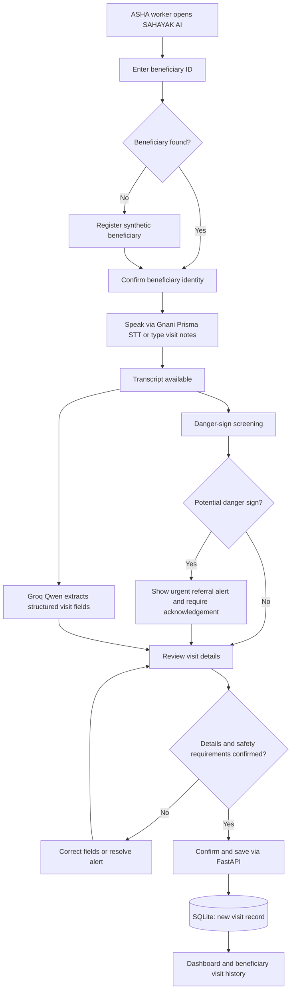
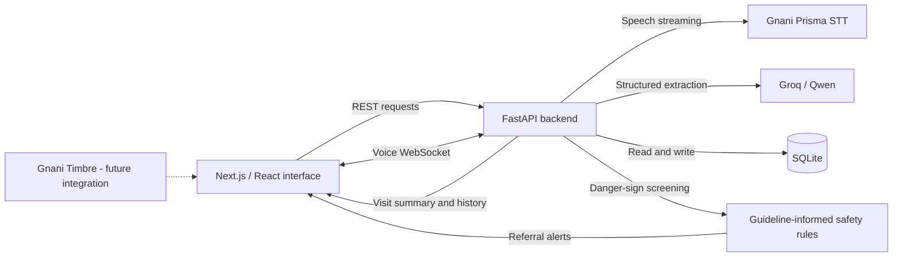

# SAHAYAK AI

### Voice-first community healthcare documentation and referral support for ASHA workers

SAHAYAK AI is an AI-assisted field companion designed around the workflows of **Accredited Social Health Activists (ASHAs)** in India. It combines multilingual speech recognition, structured visit documentation, beneficiary history, and guideline-informed danger-sign alerts to make home-visit records easier to capture and review.


## The problem

ASHA workers conduct home visits, track maternal and child health, monitor follow-ups, and help connect families with health services. Manual documentation can be time-consuming, particularly when field notes must be converted into structured records. Language differences and inconsistent follow-up records can add friction to this process.

## Our solution

SAHAYAK AI provides a simple, voice-first workflow:

- **Multilingual interaction:** Capture a visit in English, Hindi, or Kannada using speech-to-text, with a typed-transcript alternative.
- **Beneficiary identification:** Look up an existing synthetic beneficiary ID or register a fictional beneficiary.
- **AI-assisted documentation:** Convert the visit narrative into structured fields using Groq-hosted Qwen.
- **Human review:** Let the ASHA worker inspect and correct extracted information before confirming a visit.
- **Visit history:** Save each confirmed encounter as a new record while retaining earlier visits for the same beneficiary.
- **Referral safety:** Check transcripts for potential danger signs and present referral alerts that require appropriate acknowledgement.

## Workflow diagram



**Important:** Extraction creates a **draft**, not a saved record. The worker must verify the beneficiary, review the fields, and explicitly confirm. A potential danger sign must not be dismissed by an AI-generated response.

## Technology stack

| Component | Technology | Role |
| --- | --- | --- |
| Frontend | Next.js, React, TypeScript | Interactive dashboard and visit-capture interface |
| UI styling | Tailwind CSS | Responsive application styling |
| Backend | Python, FastAPI, Pydantic | REST API, validation, and WebSocket voice session |
| Speech-to-text | Gnani Prisma | Streaming voice transcription |
| AI extraction | Groq API with Qwen | Converts visit narratives into structured data |
| Database | SQLite | Stores synthetic beneficiaries, visits, and alerts |
| Referral safety | Python rules in `backend/app/safety.py` | Screens transcripts for configured danger signs |
| Text-to-speech | Gnani Timbre | Future spoken assistant responses |
| Development | Git, GitHub, VS Code | Source control and collaboration |

## System architecture



## Core visit data

A structured visit may contain:

| Field | Description |
| --- | --- |
| Beneficiary ID | Verified synthetic beneficiary identifier |
| Beneficiary name | Name associated with the selected fictional record |
| Visit type | Pregnancy, newborn, child, postnatal, or general |
| Weight | Weight in kilograms, when stated |
| Vaccinations due | Follow-up immunization details, when stated |
| Next visit date | Planned follow-up date, when stated |
| Transcript | Spoken or typed narrative used for extraction |
| Danger-sign alert | Potential warning sign and referral acknowledgement, when applicable |

Missing information should remain blank for human review rather than being invented. **Each confirmed visit creates a separate visit-history entry**, and the dashboard can present the latest entry for each beneficiary while retaining older records.

## Danger-sign detection and referral safety

SAHAYAK AI's referral-safety design is informed by the following **four public-health training and operational references** provided for the project:

| No. | Reference document | Intended relevance |
| --- | --- | --- |
| 1 | **Skills that Save Lives — ASHA Module 6 (English)** | ASHA-level maternal and child health skills and recognition/referral guidance |
| 2 | **Revised Home Based Newborn Care (HBNC) Operational Guidelines, 2014 (English)** | Home-based newborn care, assessment, and referral workflows |
| 3 | **Newborn and Child Health Services — Training Manual for CHO at AB-HWC** | Newborn and child health assessment and escalation at the health and wellness centre level |
| 4 | **RMNCAH+N Manual on Counselling, 2021** | Reproductive, maternal, newborn, child, and adolescent health counselling context |

**Source note:** These four titles are taken from the reference-file names shown in the project materials. The full PDFs were not available for page-by-page review when preparing this README. The table identifies the intended reference set; it does **not** claim that a specific symptom threshold or page citation has already been verified against the manuals. The complete documents should be kept in the project's reference collection and their issuing authority, edition, section, and page number checked before finalizing clinical rules.

### Referral-safety approach

1. Screen the visit narrative for potential danger signs **independently of AI-generated extraction**.
2. Interpret a potential warning sign in the appropriate population context (pregnancy, postnatal, newborn, or child).
3. Display a prominent warning directing the worker toward **prompt assessment or referral through the applicable public-health pathway**.
4. Require explicit acknowledgement when a referral warning is triggered, and preserve the alert in the record.
5. Keep the worker in control of documentation and referral decisions; do not generate diagnoses or treatment prescriptions.

Examples of **candidate signs for verification against the four manuals** include heavy bleeding or convulsions in maternal care; poor feeding, convulsions, or breathing difficulty in newborns; and inability to drink, convulsions, or unusually reduced responsiveness in children. These examples are **not a complete, validated danger-sign list**. The precise signs, age-specific thresholds, urgency, wording, and referral steps must be transcribed and verified from the cited manuals by qualified clinical/public-health reviewers.

**Safety principle:** A missing alert does not mean a patient is safe. Speech recognition, language variation, negation, and keyword matching can affect detection. Urgent symptoms require assessment through established healthcare pathways regardless of what the application displays.

## Getting started

### Prerequisites

- Node.js and npm (or the package manager specified by the repository lockfile)
- Python 3.10+ and `pip`
- Git
- Groq API credentials for the configured Qwen model
- Gnani Prisma credentials for voice transcription

### 1. Clone the repository

```bash
git clone <YOUR_GITHUB_REPOSITORY_URL>
cd <YOUR_REPOSITORY_FOLDER>
```

### 2. Start the backend

From the repository root, open a terminal:

```powershell
cd backend
python -m venv .venv
.\.venv\Scripts\Activate.ps1
pip install -r requirements.txt
```

Configure the required credentials in the environment file expected by the backend. For example:

```dotenv
GROQ_API_KEY=your_groq_api_key
GROQ_MODEL=your_supported_qwen_model
```

Add the Gnani Prisma settings required by `backend/app/gnani_stt.py`. Keep credentials out of Git.

```powershell
python -m uvicorn app.main:app --host 127.0.0.1 --port 8000 --reload
```

Backend health endpoint: `http://127.0.0.1:8000/health`  
Interactive API docs: `http://127.0.0.1:8000/docs`

### 3. Start the frontend

In a second terminal, from the repository root:

```powershell
npm install
npm run dev
```

Optional `.env.local` configuration:

```dotenv
NEXT_PUBLIC_API_URL=http://127.0.0.1:8000
NEXT_PUBLIC_WS_URL=ws://127.0.0.1:8000/ws/voice
```

Open `http://localhost:3000`. Browser microphone access requires permission and a secure context such as localhost or HTTPS.

## API overview

| Method | Endpoint | Description |
| --- | --- | --- |
| `GET` | `/health` | Backend health check |
| `GET` | `/api/beneficiaries` | List synthetic beneficiaries |
| `GET` | `/api/beneficiaries/{beneficiary_id}` | Find beneficiary by ID |
| `POST` | `/api/beneficiaries/register` | Register a fictional beneficiary |
| `POST` | `/api/extract` | Generate a structured visit draft using Qwen |
| `POST` | `/api/visits/confirm` | Confirm and persist a visit |
| `GET` | `/api/visits` | Retrieve visit history |
| `GET` | `/api/alerts` | Retrieve referral alerts |
| `WS` | `/ws/voice` | Voice transcription and session events |

## Repository structure

```text
sahayak-ai/
├── app/                              # Next.js routes and global styles
├── src/
│   ├── components/
│   │   ├── sahayak-app.tsx           # Main app and dashboard
│   │   └── sahayak-live-screen.tsx   # Voice, extraction, review and save
│   └── data/                         # UI translations and synthetic demo fixtures
├── backend/
│   ├── app/
│   │   ├── main.py                   # FastAPI routes
│   │   ├── database.py               # SQLite persistence
│   │   ├── groq_llm.py               # Qwen integration
│   │   ├── gnani_stt.py              # Prisma speech-to-text
│   │   ├── safety.py                 # Danger-sign screening
│   │   ├── schemas.py                # Request and response models
│   │   └── session.py                # Voice-session orchestration
│   └── requirements.txt
└── README.md
```

## Future integrations

| Integration | Opportunity |
| --- | --- |
| Gnani Timbre TTS | Spoken summaries, clarifications, and multilingual voice responses |
| ABDM-compatible interoperability | Explore consent-based, standards-aligned exchange with approved health systems, subject to applicable approvals |
| Government/public-health reporting | Structured reporting and follow-up synchronization through authorized integrations |
| Offline-first mobile experience | Local capture and queued synchronization for low-connectivity field settings |
| SMS or messaging reminders | Consent-based follow-up reminders and appointment communication |
| Multilingual language expansion | Additional regional languages and improved clinical vocabulary recognition |
| Analytics and supervisor dashboards | Aggregate, privacy-conscious follow-up and service-delivery insights |
| Role-based access and audit trails | Access controls and traceable changes for any future real-world deployment |

## Business model

SAHAYAK AI is envisioned primarily as a **public-health / institutional solution**, rather than a direct-to-patient paid application.

| Model | Potential customer or partner | Value proposition |
| --- | --- | --- |
| Institutional SaaS licensing | NGOs, community-health organizations, healthcare delivery partners | Field documentation, configurable workflows, and support |
| Government or public-health pilots | State/district health programmes and implementation partners | Evaluation of time savings, follow-up tracking, and referral workflows |
| Implementation and integration services | Health-system operators and technology partners | Deployment, localization, interoperability, and training |
| Enterprise support | Large community-health networks | Maintenance, administration, reporting, and service-level support |

**Commercial approach:** Begin with a synthetic-data demonstration, progress to an ethically reviewed and authorized pilot, measure documentation time, record completeness, and referral-workflow usability, and then explore institutional procurement or partnerships. Any real-data deployment would require appropriate privacy, security, consent, clinical governance, and regulatory review. **Beneficiary health data is not a product for sale.**

## Reference materials

The referral-safety reference set consists of:

1. *Skills that Save Lives — ASHA Module 6 (English).* Public-health training reference; verify issuing authority and edition against the source PDF.
2. *Revised Home Based Newborn Care (HBNC) Operational Guidelines (2014, English).* Public-health operational reference; verify issuing authority and relevant sections against the source PDF.
3. *Newborn and Child Health Services — Training Manual for CHO at AB-HWC.* Public-health training reference; verify edition and relevant sections against the source PDF.
4. *RMNCAH+N Manual on Counselling (2021).* Public-health counselling reference; verify full title, issuing authority, and relevant sections against the source PDF.

For additional background on child danger-sign assessment and referral, see the [World Health Organization's Integrated Management of Childhood Illness (IMCI)](https://www.who.int/teams/maternal-newborn-child-adolescent-health-and-ageing/child-health/integrated-management-of-childhood-illness).

---

**SAHAYAK AI — supporting ASHA workers with simpler documentation, better follow-up visibility, and referral-aware workflows.**
